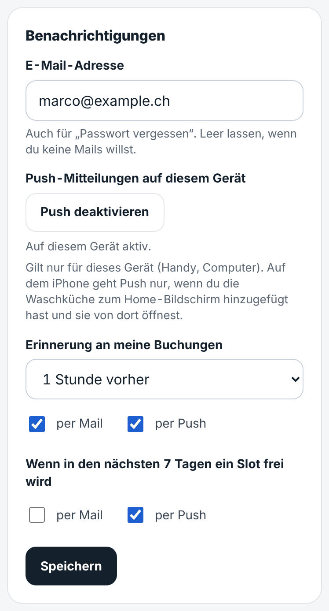
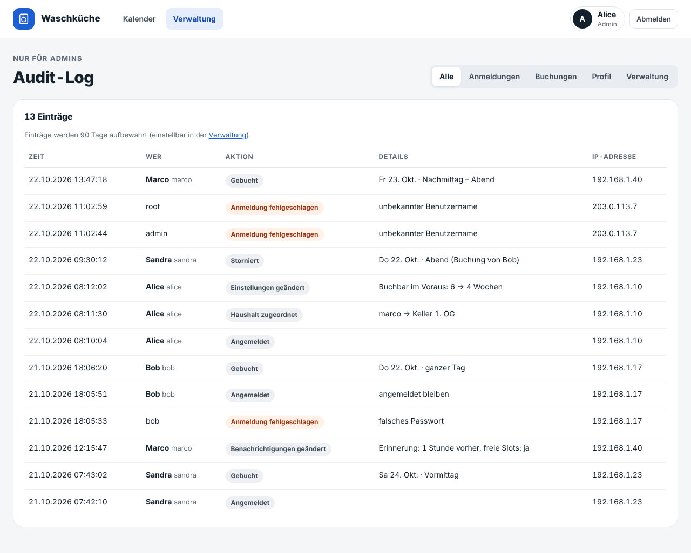

# Laundry Booking

A small web app for booking the shared washing machine in an apartment building.
Project page: https://martigr.github.io/laundry-booking/
Residents see a week calendar with three slots per day and book a free slot with one click.
Whoever is first gets the slot; if something doesn't fit, people talk to each other.

## Screenshots


<table>
  <tr>
    <td width="32%" valign="top">
      <br><sub>On the phone</sub><br><br>
      <br><sub>Notifications by mail and push</sub>
    </td>
    <td valign="top">
      <br><sub>Month overview</sub><br><br>
      <br><sub>Admin area</sub><br><br>
      <br><sub>Audit log</sub>
    </td>
  </tr>
</table>


## Features

- Login per resident (user with a free display name), several residents can form a household; "stay signed in" option
- Week view (default) and month overview, usable on phones
- Daily slots: Vormittag 07–12, Nachmittag 12–17, Abend 17–22
- One click on a free slot books it, one click on your own booking cancels it
- "Ganzer Tag" books all free slots of a day at once
- Adjacent bookings show up as one block in your upcoming bookings (and cancel together)
- Short note on a booking (up to 80 characters, e.g. "Hole die Wäsche erst um 13 Uhr"): a small badge on the
  slot, a click opens it (or, on your own booking, a form to write it)
- Households: residents that an admin groups into a household see each other's bookings as their own
  and can cancel them
- "Now in the laundry room" card, next free slot and your upcoming bookings
- Past slots can't be booked or cancelled; booking is possible up to N weeks ahead
- Minimal admin area: create/delete users, group them into households, reset passwords, set the booking horizon;
  admins can cancel any booking
- Audit log for admins: logins and failed login attempts, bookings and cancellations, profile and admin changes,
  with time and IP address; entries are deleted after a configurable number of days (default 90)
- Installable as a home screen app (icon, opens without the browser bar); a service worker shows an
  offline page when the server can't be reached, pages themselves are never cached
- Help page for residents ("Hilfe") with screenshots: how to book a slot or a whole day and how to cancel
- The app version is shown at the bottom of every page (when logged in)
- Privacy notice at `/privacy` (German, public), linked in the footer of every page: who runs the app,
  which data it keeps, who sees what, how long, the session cookie (the only cookie, so no cookie banner)
- Notifications by mail and/or push, chosen per user in the profile: reminder before your own
  booking (30 min to 1 day ahead, one reminder for back-to-back slots), "a slot became free" in the next 7 days;
  plus "forgot password" by mail; addresses are confirmed by a link first; every mail has a one-click unsubscribe
  link; push is switched on per device with one button (Web Push, no third-party account)
- Calendar subscription: your own bookings, or those of your whole household, as an iCal feed for the phone's calendar
  (iPhone, Android with ICSx⁵, Google Calendar); the secret link can be renewed or deleted in the profile
- Security: CSRF protection on all forms, login throttling, strict security headers (CSP),
  sessions end on password change; see [SECURITY.md](SECURITY.md)
- German UI

## Quick start (development)

Requires Python 3.13.

```bash
python -m venv .venv && . .venv/bin/activate
pip install -r requirements-dev.txt
flask --app laundry --debug seed-demo   # demo users: alice / password123 (admin), bob / password456
flask --app laundry --debug run         # http://localhost:5000
```

In debug mode a development `SECRET_KEY` is used and the database is created at `instance/laundry.db`.

Run the checks:

```bash
ruff check .
pytest
```

## Production (Docker Compose)

```bash
cp .env.example .env && chmod 600 .env   # fill in SECRET_KEY, admin, BASE_URL and the mail settings
docker compose up -d --build
```

The app listens on `127.0.0.1:5000` only; put an HTTPS reverse proxy in front of it (see *HTTPS* below).

This starts two containers from the same image and the same `/data` volume:

- `web`: the app (Gunicorn) on port 5000
- `notifier`: runs `flask --app laundry send-notifications --loop 60`, which queues due reminders and
  sends all waiting mails and push messages once a minute. Without mail and push settings it just idles.

### Prebuilt image

Every release publishes the image to the GitHub Container Registry (`linux/amd64` and
`linux/arm64`), so you don't need to build it yourself:

```bash
docker pull ghcr.io/martigr/laundry-booking:1   # tags: latest, 1, 1.0, 1.0.0
```

To use it with Docker Compose, replace `build: .` and `image: laundry-booking` in both services of
`docker-compose.yml` with `image: ghcr.io/martigr/laundry-booking:1`, then `docker compose up -d`.
In the `docker run` example below, use `ghcr.io/martigr/laundry-booking:1` instead of building.
The tag `1` follows all 1.x releases; pin a full version (`1.0.0`) to update only by hand.
Pre-releases (e.g. `1.6.0-beta.1`, for a staging instance) are only published under their full
version, so `1` and `latest` never get them.

### Plain `docker run`

```bash
docker build -t laundry-booking .
docker run -d --name laundry -p 127.0.0.1:5000:5000 \
  -v laundry-data:/data \
  -e SECRET_KEY="$(python3 -c 'import secrets; print(secrets.token_urlsafe(48))')" \
  -e ADMIN_USERNAME=admin -e ADMIN_PASSWORD='at-least-10-characters' \
  laundry-booking
```

- The app runs as an unprivileged user (UID/GID 1000 by default); the database lives in `/data`.
- `ADMIN_USERNAME`/`ADMIN_PASSWORD` create the first admin when the database has no users yet.
  Afterwards the admin creates all other users in the app under *Verwaltung*.
- Serve it behind HTTPS (see *HTTPS* below) with `SESSION_COOKIE_SECURE=1` and `TRUSTED_PROXIES=1`.
- Keep the `SECRET_KEY`: changing it logs everybody out and invalidates the links in sent mails.
- `/health` is used by the Docker health check.

### Volumes and permissions

SQLite needs write access to the database file **and** its folder. The container starts as
root only long enough to give `/data` to the app user, then drops to that user:

| Setup | What happens |
|---|---|
| Named volume (`-v laundry-data:/data`) | Works as is. |
| Host folder (`-v /srv/laundry:/data`) | The entrypoint changes the owner of the folder and the `laundry.db*` files to `PUID:PGID`. Set `-e PUID=$(id -u) -e PGID=$(id -g)` so they stay owned by your host user (handy for backups). |
| `docker run --user 1234:1234` | No owner change (no root). The folder must already be writable for that UID: `sudo chown 1234:1234 /srv/laundry`. |

If the folder is not writable, the app stops at startup and names the path, the owner and the
`chown` command to fix it.

Run CLI commands as the app user, otherwise root may create database files the app can't write:
`docker exec -it --user 1000:1000 laundry flask --app laundry create-user ...` (use your `PUID:PGID`).
A restart fixes the ownership again.

Without Docker: `gunicorn --workers 2 --bind 0.0.0.0:5000 "laundry:create_app()"` with the same environment variables.

### HTTPS (reverse proxy)

The app itself speaks plain HTTP. Put a reverse proxy in front of it that terminates HTTPS, and
keep port 5000 reachable only from that proxy (`127.0.0.1:5000`, as in `docker-compose.yml`).
[Caddy](https://caddyserver.com/) on the same host gets the certificate by itself:

```
# /etc/caddy/Caddyfile
waschkueche.example.ch {
    reverse_proxy 127.0.0.1:5000
}
```

With nginx (certificate e.g. from certbot):

```nginx
location / {
    proxy_pass http://127.0.0.1:5000;
    proxy_set_header Host $host;
    proxy_set_header X-Forwarded-For $proxy_add_x_forwarded_for;
    proxy_set_header X-Forwarded-Proto $scheme;
}
```

Then set in `.env`:

- `SESSION_COOKIE_SECURE=1`: the session cookie is only sent over HTTPS.
- `TRUSTED_PROXIES=1`: the app trusts the `X-Forwarded-For`/`-Proto` headers of one proxy. It needs
  them for the real client address (login throttling, logs) and to know the request came over
  HTTPS (then it sends `Strict-Transport-Security`). Use the number of proxies in the chain; leave
  it at `0` when nothing sits in front of the app, otherwise clients can fake their address.
  Without it, every request seems to come from the proxy (or Docker's gateway), so the limit of
  20 failed logins per address applies to all residents together.
- `BASE_URL=https://waschkueche.example.ch` for the links in mails and the calendar link.

### Backup and restore

All data lives in one SQLite file. `flask backup` copies it consistently while the app runs:

```bash
docker compose exec --user 1000:1000 web flask --app laundry backup /data/backup.db
docker compose cp web:/data/backup.db ./laundry-$(date +%F).db
docker compose exec web rm /data/backup.db
```

Run this daily (cron) and keep copies on another machine. Backups contain password hashes and mail
addresses: store them private (`chmod 600`) or encrypted, and delete old ones.

Example for a NAS mounted via NFS: [`scripts/backup-nas.sh`](scripts/backup-nas.sh) writes a backup
with `flask backup` in a one-off container directly to the NAS and deletes backups older than 30 days.
It refuses to run when the NAS is not mounted, writes under a temporary name (an aborted run leaves no
broken backup) and creates the files readable only by the app user (UID 1000, so the NFS export must
let it write). Settings: `BACKUP_DIR` (default `/mnt/nas/laundry-booking`), `KEEP_DAYS` (default 30).
Run it daily, e.g. with a systemd timer:

```ini
# /etc/systemd/system/laundry-backup.service
[Unit]
Description=Back up laundry-booking to the NAS
RequiresMountsFor=/mnt/nas/laundry-booking

[Service]
Type=oneshot
ExecStart=/srv/laundry-booking/scripts/backup-nas.sh

# /etc/systemd/system/laundry-backup.timer
[Timer]
OnCalendar=*-*-* 03:00
Persistent=true

[Install]
WantedBy=timers.target
```

`systemctl enable --now laundry-backup.timer`; check with `systemctl list-timers` and
`journalctl -u laundry-backup`. Snapshots on the NAS (e.g. Synology Snapshot Replication) add
a longer history.

Try a restore once, before you need it:

```bash
docker compose stop
docker compose run --rm --no-deps --entrypoint sh -v "$PWD":/backup web \
  -c 'cp /backup/laundry-2026-10-17.db /data/laundry.db && rm -f /data/laundry.db-wal /data/laundry.db-shm'
docker compose start      # the entrypoint gives the restored file back to the app user
```

Without Docker: `flask --app laundry backup <file>`; to restore, stop the app and replace the
database file (delete `laundry.db-wal` and `laundry.db-shm` next to it).

### Updates

```bash
git pull
docker compose build --pull && docker compose up -d   # --pull also gets security fixes of the base image
```

With the prebuilt image: `docker compose pull && docker compose up -d`. Releases are listed under
*Releases* on GitHub.

Update at least monthly. To hear about security fixes, watch the repository on GitHub
(*Watch → Custom → Security alerts*).

### Logs

`docker compose logs web` shows requests and logins. Failed logins are logged as
`Failed login for 'name' from <address>`, blocked ones as `Login blocked`; after 10 failures for a
username or 20 from one address within 15 minutes, logins are refused for the rest of that time.
Logs contain IP addresses and usernames; `docker-compose.yml` therefore keeps at most 3 × 10 MB per
container. The tokens of mail links (password reset, unsubscribe, confirm address) and of calendar links appear
as `***` in the app's access log. Your reverse proxy logs them in full if it keeps an access log (nginx does
by default, Caddy doesn't): turn it off for these paths or keep those logs short and private.

The **audit log** (*Verwaltung → Audit-Log*) shows who logged in (or tried to), booked, cancelled or
changed settings, with the IP address. It lives in the database, not in the container logs; entries
older than *Audit-Log aufbewahren (Tage)* (admin settings, default 90) are deleted automatically.

### Security checklist

Before the app goes online:

- [ ] HTTPS reverse proxy in front, port 5000 not reachable from outside
- [ ] `SESSION_COOKIE_SECURE=1`, `TRUSTED_PROXIES` matches the proxies, `BASE_URL` uses `https://`
- [ ] `SECRET_KEY` long and random (`python3 -c 'import secrets; print(secrets.token_urlsafe(48))'`)
- [ ] `.env` readable only by you (`chmod 600 .env`) and never committed
- [ ] After the first start: log in, change the admin password in the profile and remove
      `ADMIN_PASSWORD` from `.env`
- [ ] `SECURITY_CONTACT` set, so people know whom to tell about a problem
- [ ] `PRIVACY_CONTROLLER` and `PRIVACY_CONTACT` set, and `/privacy` read once: it names hosting and mail
      providers only in general terms, so check that it fits your setup (e.g. servers abroad)
- [ ] Daily backups on another machine, restore tried once
- [ ] Updates at least monthly (`docker compose build --pull`)

### Mail (Infomaniak)

Use a mailbox of your domain, e.g. `waschkueche@example.ch`, and set in `.env`:

```
SMTP_HOST=mail.infomaniak.com
SMTP_PORT=587               # or 465 with SMTP_SECURITY=ssl
SMTP_SECURITY=starttls
SMTP_USER=waschkueche@example.ch
SMTP_PASSWORD=...           # the mailbox password
MAIL_FROM=waschkueche@example.ch   # the mailbox itself or one of its aliases
BASE_URL=https://waschkueche.example.ch
```

Any other SMTP provider works the same way. Mails are queued in the database and sent by the
`notifier`; if the mail server is unreachable they are retried (up to 5 times) and dropped once
they are no longer relevant (e.g. a reminder after the slot started). Residents enter their address
and choose their notifications under *Profil*; they get mails only after confirming the address
with the link in the first mail; the "Passwort vergessen?" link on the login page
only appears when mail is configured.

For local development, [Mailpit](https://mailpit.axllent.org/) catches all mails in a web inbox:
`docker run -d -p 1025:1025 -p 8025:8025 axllent/mailpit`, then `SMTP_HOST=localhost SMTP_PORT=1025
SMTP_SECURITY=none MAIL_FROM=test@example.ch` and open http://localhost:8025.

### Push notifications

Residents can get reminders and "a slot became free" as push messages on their phone or computer, in
addition to or instead of mails. It uses Web Push directly (no Firebase or other account). Create a key
once and put it into `.env`:

```bash
docker compose run --rm web flask --app laundry gen-vapid-key   # prints VAPID_PRIVATE_KEY=...
```

```
VAPID_PRIVATE_KEY=...        # keep it secret and keep it: a new key ends all existing push subscriptions
VAPID_SUBJECT=mailto:verwaltung@example.ch   # optional, default mailto:MAIL_FROM (or BASE_URL)
```

Restart both containers. Under *Profil → Benachrichtigungen* each resident taps "Push aktivieren"
on every device that should get messages and ticks "per Push" for the notifications they want.

- Needs HTTPS with a valid certificate. Over plain HTTP the button doesn't appear.
- iPhone/iPad (iOS 16.4 or later): only in the home screen app (see *Home screen app*), not in Safari.
- The `notifier` container needs outbound HTTPS to the browsers' push services: `fcm.googleapis.com`
  (Chrome, Edge on Android), `*.push.services.mozilla.com` (Firefox), `*.push.apple.com` (Safari) and
  `*.notify.windows.com` (Edge on Windows). Only these hosts are accepted as push endpoints.
- Messages are end-to-end encrypted; the push service only sees when a message goes to which device.
- If you ever replace the key, residents tap "Push aktivieren" again.

### Calendar subscription

Every resident can create a personal calendar link under *Profil → Kalender abonnieren*
(`BASE_URL/calendar/<token>.ics`). It contains their own bookings, or, if an admin has put them
into a household (*Verwaltung → Haushalte*), the bookings of all its members, each named, with their notes. Calendar apps fetch it
themselves, so new bookings show up after the next refresh, not instantly:

- **iPhone/iPad:** tap the `webcal://` link in the profile, or *Settings → Calendar → Accounts →
  Add Account → Other → Add Subscribed Calendar*. iOS refreshes about hourly.
- **Android:** the app [ICSx⁵](https://icsx5.bitfire.at/) subscribes on the device and writes into
  the normal calendar; set the interval to 1 hour.
- **Google Calendar:** *Other calendars → From URL* in the browser. Google fetches the feed from its
  own servers, so the app must be reachable from the internet, and it refreshes only every few
  hours to a day.

The link needs HTTPS with a valid certificate (iOS rejects self-signed ones) and a correct
`BASE_URL`. Anyone with the link sees that household's bookings; "Neuen Link erstellen"
in the profile makes the old one stop working.

### Home screen app

Residents can put the app on their home screen (iPhone: Safari → *Share → Add to Home Screen*;
Android: browser menu → *Install app*). It then opens with its own icon and without the address bar.
Nothing needs to be configured. Over HTTPS (or on `localhost`) the browser also installs a small
service worker (`/sw.js`) that shows a "Keine Verbindung" page when the server can't be reached;
over plain HTTP that part is skipped. On the iPhone the home screen app keeps its own cookies, so
residents log in there once more.

## Configuration

| Variable | Default | Purpose |
|---|---|---|
| `SECRET_KEY` | – (required outside debug mode) | Session signing |
| `DATABASE` | `instance/laundry.db` (`/data/laundry.db` in Docker) | SQLite file |
| `APP_TIMEZONE` | `Europe/Zurich` | Defines "today" and "now" |
| `ADMIN_USERNAME`, `ADMIN_PASSWORD` | – | First admin on an empty database (password at least 10 characters) |
| `SESSION_COOKIE_SECURE` | `0` | Set to `1` behind HTTPS |
| `TRUSTED_PROXIES` | `0` | Number of reverse proxies whose `X-Forwarded-For`/`-Proto` headers are trusted (see *HTTPS*) |
| `SECURITY_CONTACT` | – | Contact for security reports in `/.well-known/security.txt`, e.g. `mailto:verwaltung@example.ch` |
| `PRIVACY_CONTROLLER` | – | Who is responsible for the data (person, association or management), shown on `/privacy` |
| `PRIVACY_CONTACT` | – | How to reach them on `/privacy`: an e-mail address (linked as `mailto:`) or an `https://` URL |
| `LOG_LEVEL` | `INFO` | Log level |
| `PUID`, `PGID` | `1000` | Docker only: user/group the app runs as and that owns `/data` |
| `BASE_URL` | `http://localhost:5000` | Public address, used for links in mails, push messages and the calendar link |
| `SMTP_HOST`, `SMTP_PORT` | –, `587` | Mail server; mail is off while `SMTP_HOST` or `MAIL_FROM` is empty |
| `SMTP_SECURITY` | `starttls` | `starttls`, `ssl` (port 465) or `none` (local test servers only) |
| `SMTP_USER`, `SMTP_PASSWORD` | – | SMTP login |
| `MAIL_FROM`, `MAIL_FROM_NAME` | –, `Waschküche` | Sender address and name |
| `VAPID_PRIVATE_KEY` | – | Key for push notifications (`flask gen-vapid-key`); push is off while it is empty |
| `VAPID_SUBJECT` | `mailto:` + `MAIL_FROM`, else `BASE_URL` | Contact for the push services (`mailto:` or `https:` URL) |

## Command line

```bash
flask --app laundry create-user <username> [--name "Display name"] [--admin]   # asks for the password
flask --app laundry make-admin <username>
flask --app laundry seed-demo                                                  # demo data, development only
flask --app laundry send-notifications [--loop SECONDS]                        # queue reminders, send mails and pushes
flask --app laundry gen-vapid-key                                              # new VAPID_PRIVATE_KEY for push
flask --app laundry backup <file>                                              # consistent copy of the database
```

In Docker: `docker exec -it --user 1000:1000 laundry flask --app laundry create-user ...` (see *Volumes and permissions*)

## Development

Architecture, data model, routes, security notes and conventions: [docs/DEVELOPMENT.md](docs/DEVELOPMENT.md).
Reporting vulnerabilities: [SECURITY.md](SECURITY.md).
Guidance for Claude Code: [CLAUDE.md](CLAUDE.md).
The project page lives in `site/` and is deployed to GitHub Pages by `.github/workflows/pages.yml`.

## License

[MIT](LICENSE)
